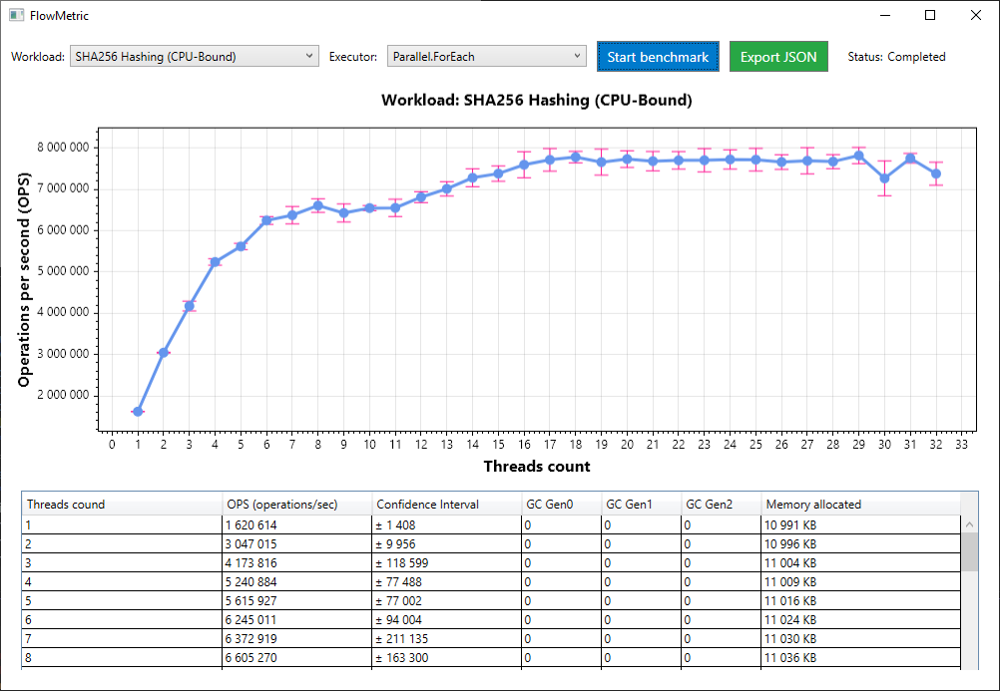

# FlowMetric 🚀

**FlowMetric** is a professional, WPF-based desktop application designed to rigorously measure, analyze, and visualize the performance of multi-threaded code in .NET 8. 

Unlike basic microbenchmarks that rely on a simple `Stopwatch`, FlowMetric focuses on **scalability** (1 to 32+ threads), **statistical reliability** (median + 95% confidence intervals), and **memory pressure** (real-time GC allocation tracking).

---

## ✨ Key Features

### 🧪 9 Realistic Workloads
Covers a wide spectrum of concurrency challenges:
*   **CPU-Bound:** `SHA256 Hashing`, `Guid Generation`, `Prime Check` (via Plugin).
*   **Memory & Synchronization:** `False Sharing`, `Contention (Lock)`, `SpinLock`, `ReaderWriterLockSlim`.
*   **Concurrency Primitives:** `ConcurrentDictionary`, `ConcurrentQueue`.
*   **I/O-Bound:** `File I/O` (Async Read/Write with OS cache bypass).

### ⚙️ 6 Execution Strategies
Compare how different parallelization approaches handle the same workload:
1. `Parallel.ForEach` (Standard .NET parallelization)
2. `Task.Run` (Manual task management)
3. `ThreadPool` (Classic `QueueUserWorkItem`)
4. `TPL Dataflow` (Pipeline with backpressure)
5. `System.Threading.Channels` (Producer-Consumer pattern)
6. `PLINQ` (Declarative parallelism)

### 📊 Rigorous Methodology
*   **Warmup:** 32 iterations to stabilize JIT and trigger Tier 1 compilation.
*   **Measurements:** 20 independent runs per thread count.
*   **Statistics:** Median calculation (robust to outliers) and **95% Confidence Intervals** using Student's t-distribution.
*   **GC Profiling:** Tracks `TotalAllocatedBytes` delta and `Gen0/1/2` collections in real-time.

### 🧩 Plugin Architecture
Extend FlowMetric without recompiling the core application. Custom workloads can be compiled into `.dll` files and loaded dynamically via an isolated `AssemblyLoadContext`.

---

## 🚀 Quick Start

1. **Clone** the repository:  
   `git clone https://github.com/tklimkina/FlowMetric.git`
2. **Open** `FlowMetric.sln` in Visual Studio 2022.
3. **Build** the solution in **Release** mode *(crucial for accurate JIT optimization and performance metrics)*.
4. **Run** `FlowMetric.exe`. 
5. Select a Workload and Executor, click **Start benchmark**, and analyze the results.
6. Click **Export JSON** to save the full report (including environment metadata) for further analysis.

### ➕ Adding Custom Plugins
1. Create a new Class Library project (.NET 8).
2. Add a project reference to `FlowMetric.Core`.
3. Implement the `IWorkload` interface.
4. Build the project and place the resulting `.dll` into the `Plugins` folder next to `FlowMetric.exe`.

---

## 📖 Documentation

For a deep dive into the statistical rigor, JIT behavior, GC profiling techniques, and the mathematical foundations used in this tool, please read the **[METHODOLOGY.md](METHODOLOGY.md)**.

---

## 🛠 Tech Stack

*   **Framework:** .NET 8 (C# 12)
*   **UI:** WPF (Windows Presentation Foundation)
*   **Visualization:** ScottPlot 5
*   **Serialization:** System.Text.Json
*   **Architecture:** Plugin-based (`AssemblyLoadContext`), Dependency Injection principles

---

## 📄 License

This project is open-source and available under the [MIT License](LICENSE).